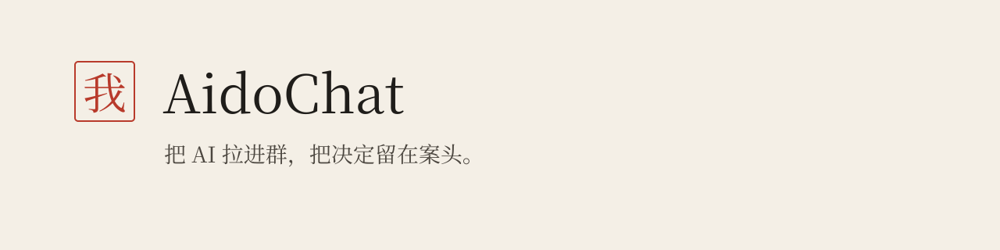

[English](README.en.md) · 简体中文

<picture><source media="(prefers-color-scheme: dark)" srcset="docs/assets/banner-night.svg"></picture>

用 @ 点名讨论，用私印确认有来源的群纪要。

  

<a href="https://gravelstars.github.io/AidoChat/">在线试玩</a> · <a href="#下载--download">下载</a> · <a href="docs/USER_GUIDE.md">文档</a>

<picture><source media="(prefers-color-scheme: dark)" srcset="docs/assets/main-night.png"></picture>

### 点名，让讨论有顺序

每位成员有自己的角色与模型。用 @ 点名单人、多人或所有人，选择依次或同时回复；随时停止、原地重试。

### 建议与定论，留下不同笔迹

  <a href="docs/assets/stamp-first.png">静态首帧</a>

每个群有独立纪要：AI 建议、你提出的条目、你盖章的决定分开呈现，来源可回到原消息。AI 不能替你确认。

### 本地保存，服务由你配置

桌面版数据保存在本机，Key 存系统钥匙串。支持 OpenAI 兼容服务、Anthropic 接口及 Ollama；图片与 TXT/Markdown/文本 PDF 可随消息导入，聊天可选起止消息导出为分页 PNG。

### 三十秒上手

1. [试玩演示](https://gravelstars.github.io/AidoChat/)：体验预设回复与盖章，无需 Key。
2. 桌面版当前从源码构建；公开二进制安装包暂不发布。
3. 在设置或新建成员表单里配置首个模型服务、Key 与实际模型名。
4. 创建群、加入成员，输入 `@墨白` 开始讨论。

### 下载 / Download

当前只公开源码与浏览器演示，不发布 Windows、macOS、Linux 二进制安装包。第三方许可审阅尚未关闭，因此请按 [构建说明](build/README.md) 从源码构建。
[公开下载与演示状态](docs/DEMO.md) · [自行构建](build/README.md)

### 换张纸，刻一方私印

六种纸、阅读字号与密度，配合完整显示名、独立短印文和图片头像；成员头像可在群内单独设置。

> [!WARNING]
> 数据保存在本机。调用云端模型时，被 @ 成员的上下文（群规则、群纪要、近期聊天记录，以及所需附件内容）会发送给该成员配置的模型服务。整理纪要时，新的讨论会发送给“整理模型”所在的服务。

### 现状与路线

0.1.2 桌面主体已可运行；本页配图来自虚构数据的浏览器演示，回复均为预设文案。手机端暂不支持；尚无云同步、联网工具或扫描 PDF OCR，Windows/Linux 安装交互仍待真机验收。后续优先完善跨平台验证，详见 [当前状态](docs/CLOSEOUT.md)。

[参与贡献](CONTRIBUTING.md) · [Apache-2.0](LICENSE)（第三方内容另循各自许可；[第三方声明](THIRD_PARTY_NOTICES.md)）
