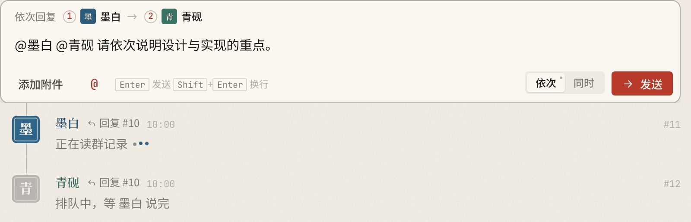
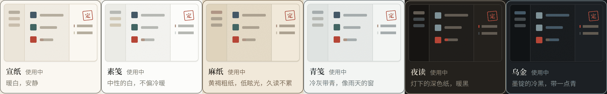
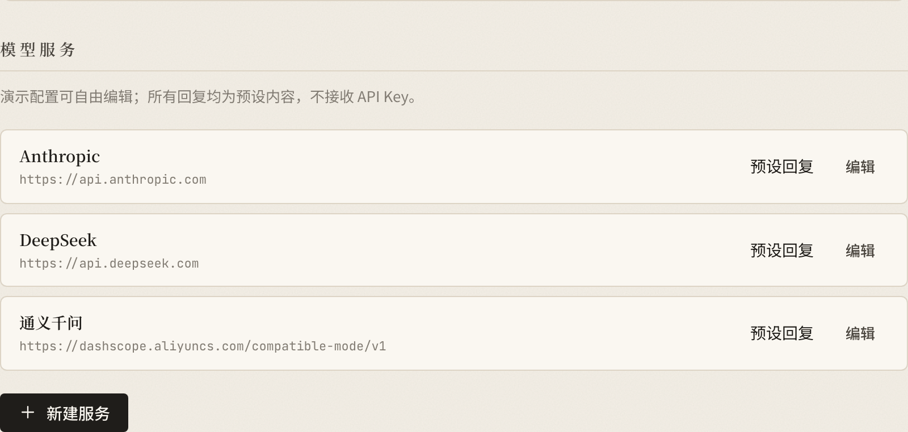

# AidoChat

<p align="center"><a href="README.en.md">English</a> · <b>简体中文</b></p>

<p align="center">
  <a href="https://github.com/gravelstars/AidoChat">
    <picture>
      <source media="(prefers-color-scheme: dark)" srcset="docs/assets/social-night.png">
      
    </picture>
  </a>
</p>

<p align="center">
  <strong>一个有温度的有趣的多AI群聊本地应用，开源，免费。</strong>
</p>

<p align="center">
  
  
  
</p>

<p align="center">
  <a href="https://github.com/gravelstars/AidoChat/releases/latest"><b>下载安装</b></a> ·
  <a href="https://gravelstars.github.io/AidoChat/"><b>在线演示</b></a> ·
  <a href="#快速开始">快速开始</a> ·
  <a href="docs/USER_GUIDE.md">使用手册</a> ·
  <a href="build/README.md">从源码构建</a>
</p>

<p align="center">
  <picture>
    <source media="(prefers-color-scheme: dark)" srcset="docs/assets/main-night.png">
    
  </picture>
</p>

<p align="center"><sub>界面截图来自浏览器演示，使用虚构数据和预设回复。</sub></p>

## 为什么是 AidoChat

- **群聊，而不是单聊**：多位 AI 成员各有角色和模型，在同一条时间线上讨论。
- **建议与定论分开**：AI 只能提出建议；只有你盖章的条目才算确认，每条都有真实来源。
- **本地优先**：聊天、附件和纪要保存在本机 SQLite；API Key 存在系统凭证存储。
- **服务由你选择**：OpenAI 兼容接口、Anthropic，或本地 Ollama。

## 下载安装

选择你的系统，直接下载 **0.1.2** 安装包：

| 系统 | 下载 | 安装 |
| --- | --- | --- |
| macOS 12+（Intel / Apple Silicon） | [AidoChat.dmg](https://github.com/gravelstars/AidoChat/releases/download/v0.1.2/AidoChat.dmg) | 打开后把 AidoChat.app 拖入「应用程序」 |
| Windows 10 / 11（x64） | [AidoChat-windows-setup.exe](https://github.com/gravelstars/AidoChat/releases/download/v0.1.2/AidoChat-windows-setup.exe) | 运行安装程序；需要 WebView2（安装器会引导） |
| Ubuntu 24.04（amd64） | [AidoChat.deb](https://github.com/gravelstars/AidoChat/releases/download/v0.1.2/AidoChat.deb) | `sudo apt install ./AidoChat.deb` |
| 其他 Linux | [AidoChat.AppImage](https://github.com/gravelstars/AidoChat/releases/download/v0.1.2/AidoChat.AppImage) | `chmod +x` 后运行；需 GTK4 / WebKitGTK 6.0 |

[全部版本与校验值](https://github.com/gravelstars/AidoChat/releases) · 不确定选哪个：Windows 选 setup.exe，macOS 选 dmg，Ubuntu 选 deb。

> macOS 安装包为 ad-hoc 签名，Windows 未做发布签名。首次打开可能需要在系统安全设置中确认来源；不要在不明来源处下载同名文件。安装或升级前请先完全退出正在运行的 AidoChat（Windows 安装器会检测并提示）。

## 功能

<p align="center">
  
</p>

### 点名，让讨论有顺序
用 `@` 点名单人、多人或所有人，选择依次或同时回复。随时停止，失败或中断的回复可以原地重新生成。

<p align="center">
  <br>
  
</p>

### 建议与定论，留下不同笔迹
AI 建议是虚线铅笔，你提出的条目是实线墨笔，盖章确认后变成朱线。来源编号可以回到原消息，AI 不能替你确认。

<p align="center">
  
</p>

### 六种纸，一方私印
宣纸、素笺、麻纸、青笺、夜读、乌金六种纸面，配合阅读字号、密度、完整显示名与独立短印文。成员头像可以在群内单独设置。

<p align="center">
  
</p>

### 数据在本地，服务由你决定
桌面版使用本机 SQLite 和系统凭证存储。图片与 TXT/Markdown/文本 PDF 可以随消息导入；选中的聊天可以导出为分页 PNG。


## 快速开始

1. **在线演示**：打开 [gravelstars.github.io/AidoChat](https://gravelstars.github.io/AidoChat/)，无需 Key。回复是预设文案，数据只保存在当前浏览器。
2. **下载桌面版**：从 [Releases](https://github.com/gravelstars/AidoChat/releases/latest) 选择对应系统的安装包；也可以按 [构建说明](build/README.md) 从源码构建。
3. **配置服务**：在设置或新建成员表单里填写服务地址、Key 和实际可用的模型名。
4. **开始讨论**：创建群、加入成员，输入 `@墨白` 或 `@所有人`。

## 从源码构建

需要 Go（版本见 `go.mod`）、Node.js 24 和对应平台的 Wails 构建环境。

```sh
go install github.com/wailsapp/wails/v3/cmd/wails3@v3.0.0-beta.29
cd frontend && npm ci && cd ..
wails3 task package
```

浏览器开发预览：

```sh
cd frontend
npm ci
npm run dev
```

更多说明见 [build/README.md](build/README.md) 和 [贡献指南](CONTRIBUTING.md)。

> [!WARNING]
> 数据保存在本机。调用云端模型时，被 @ 成员的上下文（群规则、群纪要、近期聊天记录和所需附件内容）会发送给该成员配置的模型服务。整理纪要时，新的讨论会发送给“整理模型”所在的服务。

## 项目状态

0.1.2 桌面主体可运行，macOS、Windows 和 Linux 安装包已发布到 [Releases](https://github.com/gravelstars/AidoChat/releases/latest)。浏览器演示使用虚构数据和预设回复。手机端暂不支持；尚无账号、云同步、联网工具、扫描 PDF OCR、Word/Excel 或视频附件。Windows/Linux 安装交互仍需更广泛的真机验收。

## 参与贡献

问题反馈和建议请通过 [Issues](https://github.com/gravelstars/AidoChat/issues) 提交。开发约定与自检命令见 [CONTRIBUTING.md](CONTRIBUTING.md)。

[参与贡献](CONTRIBUTING.md) · [Apache-2.0](LICENSE)（第三方内容另循各自许可；[第三方声明](THIRD_PARTY_NOTICES.md)）
